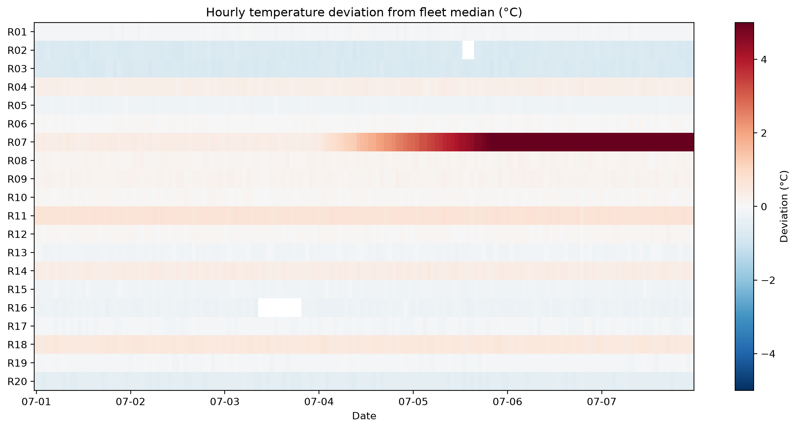
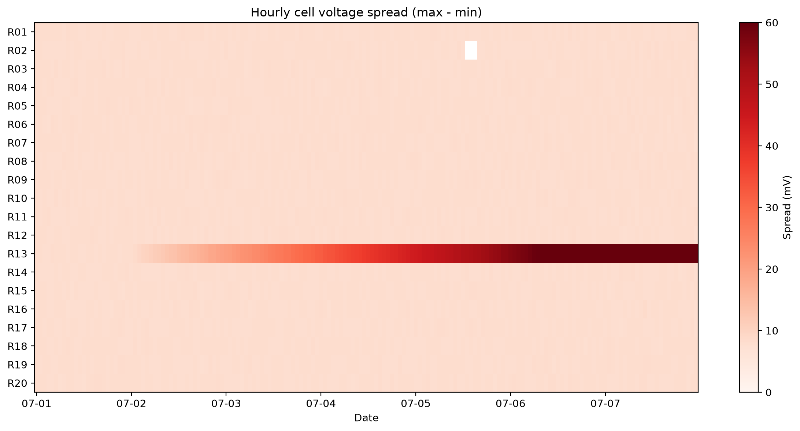

# BESS Operating Data: Data Quality Checks and Anomaly Detection

A Python workflow for screening battery energy storage system (BESS) operating data: cleaning sensor problems, detecting abnormal racks, and producing an alarm summary and daily report that operators can use directly.

## Motivation

A utility-scale BESS produces large volumes of rack-level telemetry (SOC, current, voltage, cell temperature) every minute. Fixed alarm thresholds catch problems only once they are already severe, and sensor faults can either trigger false alarms or silently hide real ones. This project explores how to:

- separate sensor and communication problems from real battery behavior,
- design alarm rules that balance false alarms against detection delay, and
- detect slowly developing faults earlier by comparing each rack against the rest of the fleet.

## Data

The dataset is **synthetic**. It is generated by `notebooks/make_bess_data.py` (written with AI assistance) to resemble BMS telemetry from an LFP storage site:

- 20 racks, 7 days, 1-minute resolution (about 200,000 rows)
- Daily schedule: charge 10:00–14:00, discharge 17:00–21:00
- Fields: timestamp, rack ID, SOC, current, rack voltage, max/min cell voltage, max cell temperature, ambient temperature

Several faults are injected into the data, and the analysis aims to find them without being told where they are. The analysis notebook is my own work.

## Methods

**1. Data quality checks**

| Problem | How it is detected |
|---|---|
| Communication loss | All rack fields missing at the same time while independent sensors (ambient) still report |
| Out-of-range readings | Physical limits on cell temperature |
| Sensor spikes | Large minute-to-minute jumps within the same rack |
| Stuck sensor | Reading unchanged for 30 consecutive minutes (rolling window, no rack hard-coded) |

Raw data is never overwritten. Bad readings are masked in a separate cleaned column, and a flag column records the reason.

**2. Rule-based alarms with persistence**

An alarm fires only when a condition holds for a sustained window (for example, temperature above 40 °C for 10 consecutive minutes). Using the rolling minimum makes isolated spikes unable to trigger an alarm.

**3. Peer comparison with a robust z-score**

At every minute, each rack's temperature is compared with the fleet median. The deviation is scaled by the median absolute deviation (MAD) rather than the standard deviation, so the faulty rack does not inflate the scale and mask itself.

**4. Reporting**

Heatmaps of the whole fleet, a combined alarm summary table, a per-day report, and an Excel export for colleagues.

## Key Results

**Earlier detection of a cooling failure (rack R07)**

| Method | First alarm | Earlier than fixed threshold | False alarms |
|---|---|---|---|
| Fixed threshold (40 °C, sustained 10 min) | Jul 5, 13:50 | — | None |
| Peer comparison, standard z-score (z > 3, sustained 30 min) | Jul 4, 18:14 | ~19.5 h | None |
| Peer comparison, robust z-score (z > 3, sustained 30 min) | Jul 4, 13:46 | ~24 h | None |



**Other findings**

- **R16, stuck temperature sensor:** the reading froze at 23.7 °C for 12 hours while the rack went through a full charge and part of a discharge. This fault passes both range checks and spike checks. During that time an over-temperature alarm could not have fired, which makes a stuck sensor more dangerous than a noisy one.
- **R11, intermittent sensor spikes:** six isolated one-minute readings of 85–120 °C with all other signals normal. Treated as invalid data and a maintenance item, not as over-temperature events.
- **R02, communication loss:** three hours of missing data (98.2% availability for the week). The battery readings were normal after recovery, but the loss of visibility is itself a risk.
- **R13, growing cell voltage imbalance:** the spread between highest and lowest cell voltage rose steadily from about 8 mV (the fleet median) to a peak of 82 mV. A 30 mV alarm sustained for 10 minutes first fired on Jul 3 at 21:57.



## Lessons Learned

- Persistence conditions reduce false alarms but add detection delay, and the delay grows much larger when a signal drifts slowly around the threshold.
- Fixed thresholds lag trends. Both the R07 and R13 faults were visible on the heatmaps more than a day before the fixed-threshold alarms fired.
- Robust statistics (median and MAD) matter when the anomaly is part of the population used to define "normal".
- Data problems usually affect specific sensors, so cleaning should be done per field rather than dropping whole rows.

## Limitations and Next Steps

- Some normal racks have persistent offsets from the fleet (their robust z-score sits near ±1.9). Subtracting each rack's own baseline would add margin against false alarms on larger sites.
- Alarms are summarized by first and last occurrence, which can make intermittent alarms look continuous. Splitting alarms into separate events would fix this.
- LFP's flat voltage curve hides imbalance in mid-SOC; a real voltage spread alarm should account for SOC.
- The data is synthetic. The next stage of this project applies similar techniques to published LFP cycling data for state-of-health analysis and lifetime prediction.

## How to Run

```bash
pip install -r requirements.txt

cd notebooks
python make_bess_data.py   # creates ../data/bess_ops.csv
jupyter notebook stage2_anomaly_detection.ipynb
```

## Repository Structure

```
├── README.md
├── requirements.txt
├── figures/
│   ├── temperature_heatmap.png
│   └── voltage_spread_heatmap.png
└── notebooks/
    ├── stage2_anomaly_detection.ipynb
    └── make_bess_data.py
```

## Tools

Python, pandas, NumPy, Matplotlib, Jupyter
